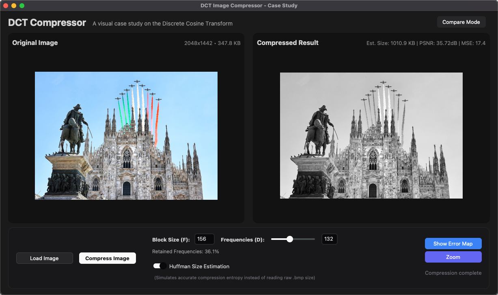
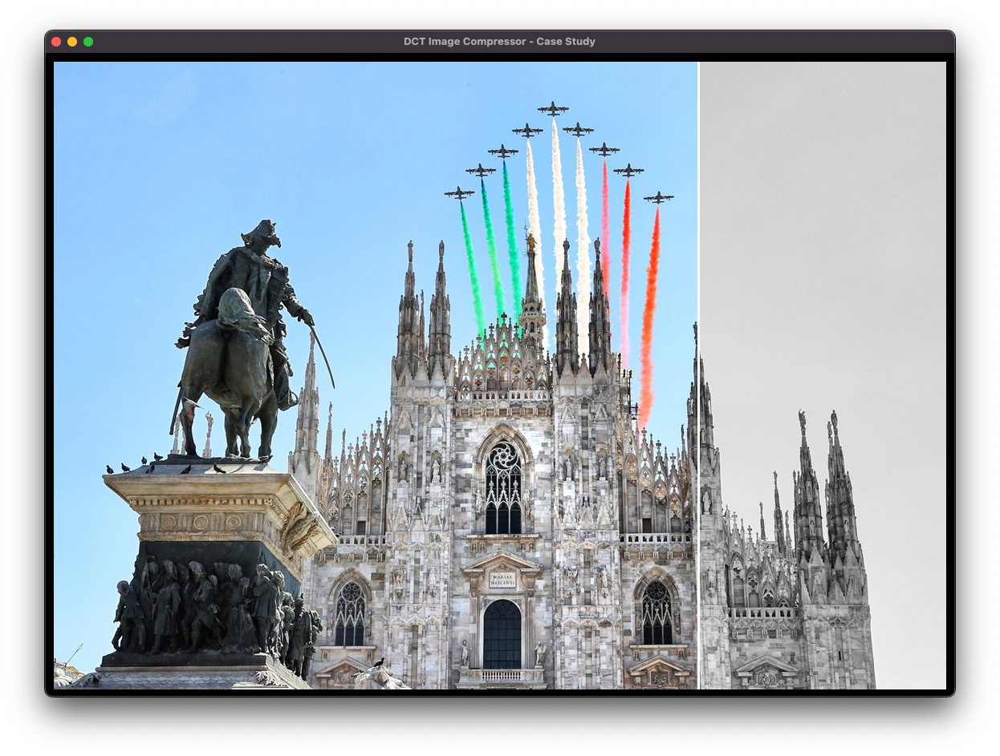
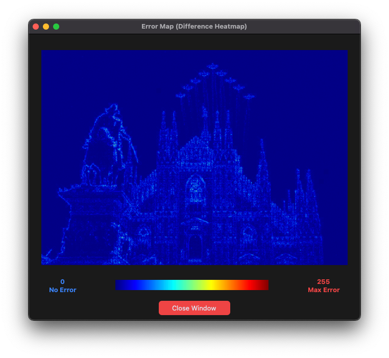
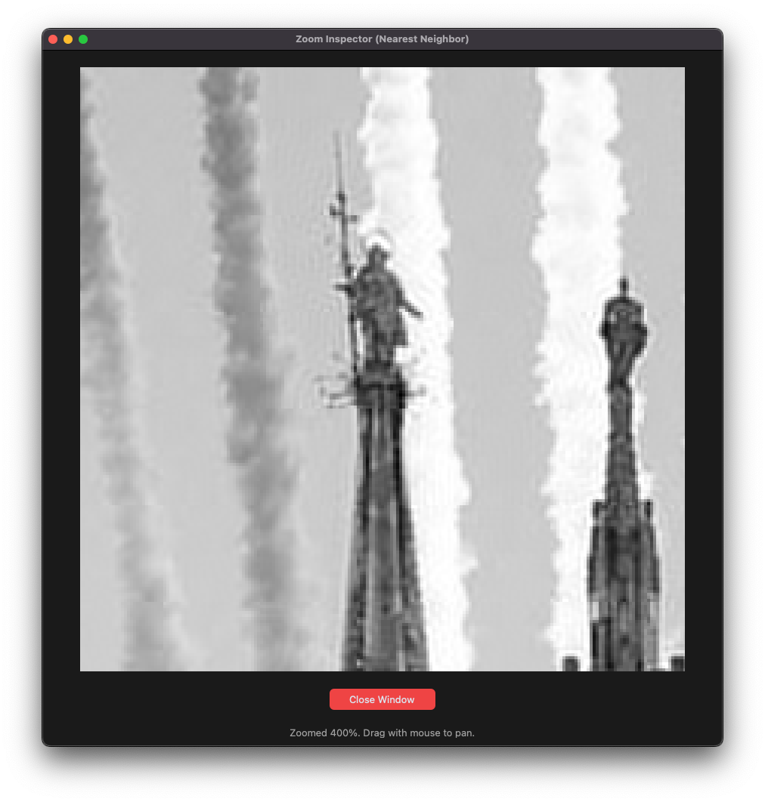

# DCT2 Image Compressor

> A comprehensive scientific simulation of JPEG-style image compression based on the 2D Discrete Cosine Transform (DCT2), implemented from scratch for grayscale images. Developed as part of an academic assignment in scientific computing.

---



---

## Key Features

- **2D DCT From Scratch:** Manual implementation of the orthogonal 2D DCT/IDCT basis matrix directly from theoretical signal projection equations ($O(N^3)$ matrix formulation).
- **Modern Dark-Mode GUI:** Responsive desktop interface built with `customtkinter` and styled after the modern Shadcn dark design system.
- **Quantitative Quality Metrics:** Real-time computation of **PSNR** (Peak Signal-to-Noise Ratio), **MSE** (Mean Squared Error), and percentage of retained spatial frequencies.
- **Theoretical Huffman Size Estimation:** Custom prefix-tree Huffman entropy encoder that calculates the theoretical compressed size in bytes and compression ratio compared to the uncompressed raw `.bmp`.
- **Visual Error Map:** Thermal JET colormap heatmap showing exactly which high-frequency edges and micro-textures were discarded, complete with an anchored 0–255 colorbar legend.
- **400% Zoom Tool:** Nearest-neighbor pixel inspection window to navigate and clearly observe 8x8 blocking artifacts without artificial smoothing.
- **Full-Screen Compare Mode:** Presentation-ready overlay slider that tracks the mouse cursor to inspect before/after differences with instant feedback (press `ESC` to exit).
- **Benchmarking Suite:** Timing comparison between custom naive matrix DCT2 and SciPy's FFT-accelerated implementation ($O(N^2 \log N)$), outputting semilogarithmic scaling plots.

---

## Visual Showcase

| Interactive Compare Slider | Thermal Error Map |
| :---: | :---: |
|  |  |
| *Full-screen interactive vertical before/after divider* | *Thermal difference heatmap with 0–255 colorbar legend* |

| 400% Zoom Tool (Blocking Artifacts) |
| :---: |
|  |
| *Pixel-perfect nearest-neighbor zoom to analyze 8x8 block boundaries* |

---

## Prerequisites

- **Python:** Version `>= 3.8` (tested up to Python 3.13).
- **Tkinter:** Typically included with official Python distributions. If you use Linux or a minimal Homebrew Python installation on macOS, install the Tkinter system package:
  - **Debian / Ubuntu / Raspberry Pi OS:**
    ```bash
    sudo apt update && sudo apt install -y python3-tk
    ```
  - **Arch Linux:**
    ```bash
    sudo pacman -S tk
    ```
  - **Fedora / RHEL:**
    ```bash
    sudo dnf install python3-tkinter
    ```
  - **macOS (Homebrew):**
    ```bash
    brew install python-tk
    ```

---

## Step-by-Step Installation

### 1. Clone the repository
```bash
git clone https://github.com/FerrarioChristian/jpeg-converter.git
cd jpeg-converter
```

### 2. Create and activate a virtual environment
```bash
# Create venv
python3 -m venv venv

# Activate venv on macOS/Linux:
source venv/bin/activate

# Or on Windows (PowerShell / Command Prompt):
# venv\Scripts\activate
```

### 3. Install dependencies and the package
Install the project in editable mode (this installs all dependencies, including `customtkinter`, `Pillow`, `opencv-python`, `numpy`, `scipy`, and `matplotlib`, and registers CLI entrypoints):
```bash
pip install --upgrade pip
pip install -e .
```

---

## Usage

### 1. Graphical User Interface (Recommended)
Launch the dark-mode GUI using either the registered command:
```bash
run-gui
```
or directly via Python:
```bash
python main.py
```

#### Inside the GUI:
1. Click **"Carica Immagine"** to select any grayscale `.bmp` image (a sample `caravaggio.jpg` is loaded by default).
2. Adjust the block size `F` (standard 8) and use the interactive slider to tune frequency cutoff `d` (`0 <= d <= 2F - 2`).
3. Toggle **"Stima Huffman"** to view real-time theoretical file size estimates alongside PSNR and MSE.
4. Click on either image in the split view to enlarge it full-canvas.
5. Use **"Show Error Map"** to inspect discarded high frequencies.
6. Use **"Zoom"** to inspect 8x8 block artifacts at 400% magnification.
7. Click **"Compare Mode"** in the top-right header for the full-screen interactive slider.

---

### 2. Command-Line Interface (CLI)
You can also run batch compressions via the CLI:
```bash
python main.py --image images/640x640.bmp -f 8 -d 8
```
The output image and compression statistics will be saved to `results/result.bmp`.

---

## Benchmarking & Tests

### Algorithm Correctness Tests
Verify the mathematical precision of custom 1D and 2D DCT implementations against predefined tolerances:
```bash
run-test
# or: python tests/test.py
```

### Computational Benchmark
Compare custom matrix DCT2 ($O(N^3)$) against SciPy's FFT-based implementation ($O(N^2 \log N)$):
```bash
run-benchmark
# or: python tests/benchmark.py
```
This generates a semilogarithmic plot saved to `results/benchmark.jpeg`.

### Parameter Sweep
Run a batch test across multiple block sizes $F \in \{8, 16, 32, 64, 128\}$ and cutoffs $D$:
```bash
run-parameter-test
# or: python tests/parameters.py
```

---

## Theoretical Overview & Notes

- **DCT2 Transformation:** Each $F \times F$ block $X$ is projected into frequency space via $Y = C \cdot X \cdot C^T$, where $C$ is the orthogonal DCT basis matrix.
- **Frequency Truncation:** High-frequency coefficients with indices $k + l \ge d$ are set to zero.
- **Inverse DCT2:** The block is reconstructed using the orthogonal transpose basis: $X' = C^T \cdot Y \cdot C$.
- **Format Support:** Standard grayscale `.bmp` images (8-bit). Border remainders not divisible by $F$ are cropped for boundary alignment.

---

## Project Structure

```
├── cli/
│   ├── __init__.py
│   └── cli.py                 # Command-line interface logic
├── converter/
│   ├── __init__.py
│   ├── backend.py             # Image loading, slicing, and compression pipeline
│   ├── dct.py                 # Pure Python 1D & 2D DCT matrix implementation
│   └── huffman.py             # Custom Huffman prefix tree entropy estimator
├── docs/
│   ├── Relazione.pdf          # Full academic scientific report (Italian)
│   ├── latex/                 # LaTeX source files for the report
│   └── screenshots/           # Application screenshots for docs and showcase
├── gui/
│   ├── __init__.py
│   ├── gui.py                 # CustomTkinter Dark-Mode application
│   └── resources/
│       └── caravaggio.jpg     # Default sample asset
├── images/                    # Benchmark and test grayscale images
├── results/                   # Destination for compressed images and benchmark plots
├── tests/
│   ├── benchmark.py           # SciPy vs Custom DCT performance benchmark
│   ├── parameters.py          # Multi-parameter batch sweep
│   └── test.py                # Mathematical validation tests
├── main.py                    # Unified entrypoint (GUI / CLI)
└── pyproject.toml             # Package metadata, dependencies, and CLI scripts
```

---

## Academic Report

The complete scientific report written for the *Metodi del Calcolo Scientifico* course (Università degli Studi di Milano-Bicocca) is available as a compiled PDF:
- [Relazione.pdf](docs/Relazione.pdf) (Italian, 15+ pages of theoretical proofs, error graphs, and algorithmic analysis).

---

## Authors

- **Christian Ferrario** – [GitHub](https://github.com/FerrarioChristian) – `c.ferrario30@campus.unimib.it`
- **Andrea Lanza** – `a.lanza13@campus.unimib.it`

---

## License

This project is licensed under the MIT License - see the [LICENSE](LICENSE) file for details.
